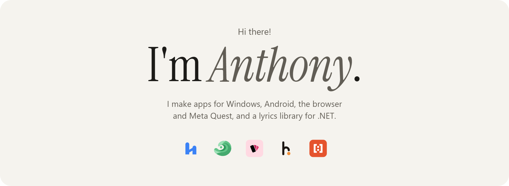
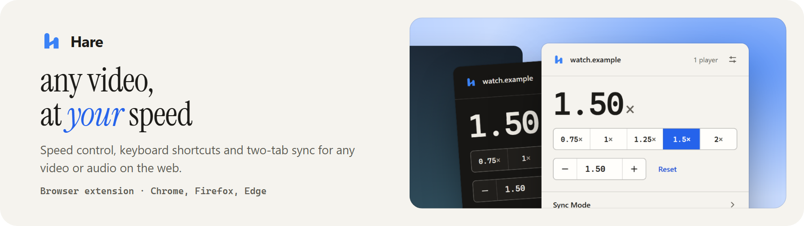
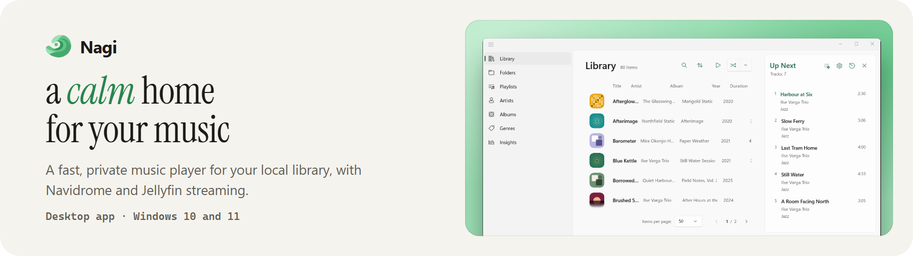
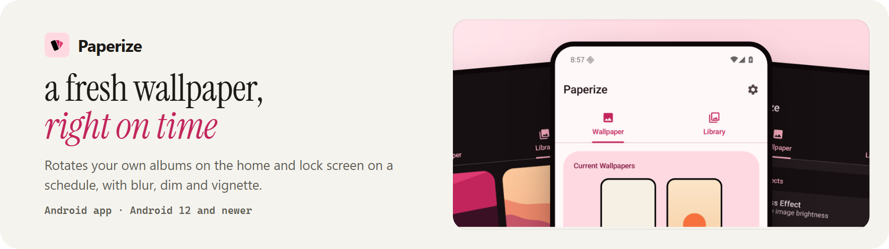
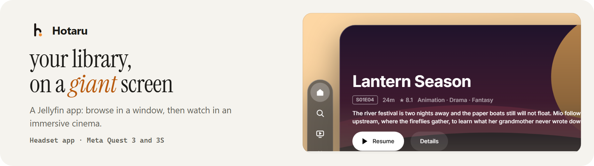
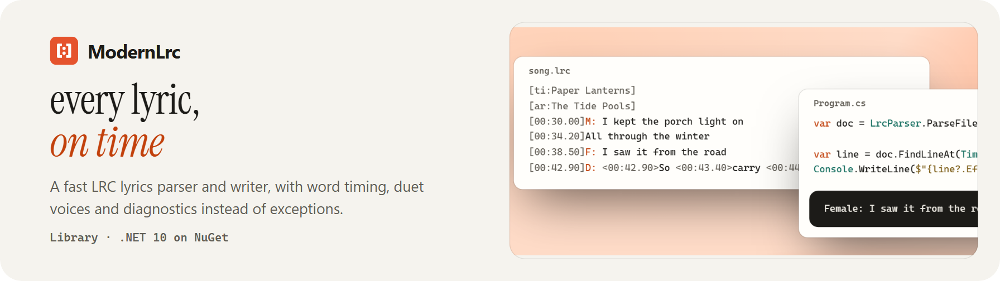

<picture>
  <source media="(prefers-color-scheme: dark)" srcset=".github/readme/hero-dark.png">
  
</picture>

Hi there! I'm Anthony. These are the projects I work on.

<a href="https://anthonyy232.github.io/Hare/">
  <picture>
    <source media="(prefers-color-scheme: dark)" srcset=".github/readme/hare-dark.png">
    
  </picture>
</a>

**Hare** is a browser extension for Chrome, Firefox and Edge that sets the speed of any video or audio on the web, from the keyboard, a controller on the player or the toolbar popup, and keeps two tabs playing in step. [Website](https://anthonyy232.github.io/Hare/) · [Source](https://github.com/Anthonyy232/Hare)

<a href="https://anthonyy232.github.io/Nagi/">
  <picture>
    <source media="(prefers-color-scheme: dark)" srcset=".github/readme/nagi-dark.png">
    
  </picture>
</a>

**Nagi** is a fast, private music player for your local library on Windows 10 and 11, and it can stream from your own Navidrome or Jellyfin server. [Website](https://anthonyy232.github.io/Nagi/) · [Source](https://github.com/Anthonyy232/Nagi)

<a href="https://anthonyy232.github.io/Paperize/">
  <picture>
    <source media="(prefers-color-scheme: dark)" srcset=".github/readme/paperize-dark.png">
    
  </picture>
</a>

**Paperize** is an Android app that changes your home and lock screen wallpaper on a schedule, from albums of your own images, with brightness, blur and vignette effects. It works offline. [Website](https://anthonyy232.github.io/Paperize/) · [Source](https://github.com/Anthonyy232/Paperize)

<a href="https://anthonyy232.github.io/Hotaru/">
  <picture>
    <source media="(prefers-color-scheme: dark)" srcset=".github/readme/hotaru-dark.png">
    
  </picture>
</a>

**Hotaru** is a Jellyfin app for Meta Quest 3 and 3S: browse your library in a window, then watch in an immersive cinema. [Website](https://anthonyy232.github.io/Hotaru/) · [Source](https://github.com/Anthonyy232/Hotaru)

<a href="https://anthonyy232.github.io/ModernLrcParser/">
  <picture>
    <source media="(prefers-color-scheme: dark)" srcset=".github/readme/modernlrc-dark.png">
    
  </picture>
</a>

**ModernLrc** is a fast LRC lyrics parser and writer for .NET 10, with word timing, duet voices and diagnostics instead of exceptions. [Documentation](https://anthonyy232.github.io/ModernLrcParser/) · [NuGet](https://www.nuget.org/packages/ModernLrc) · [Source](https://github.com/Anthonyy232/ModernLrcParser)

### Other work

- [CI-Sight](https://github.com/Anthonyy232/CI-Sight): a dashboard that collects GitHub Actions failures and diagnoses them with sentence embeddings, pgvector similarity search and a local LLM through Ollama.
- [ecg-convnextv2-classifier](https://github.com/Anthonyy232/ecg-convnextv2-classifier): an ECG arrhythmia classifier using a ConvNeXt V2 model in PyTorch, trained on the MIT-BIH Arrhythmia Database, with S-transform features and ONNX export.
- [mpvconfigs](https://github.com/Anthonyy232/mpvconfigs): my mpv.net configuration, with the ModernZ on-screen controller.

### Contact

[anthonyyla.dev@gmail.com](mailto:anthonyyla.dev@gmail.com)
